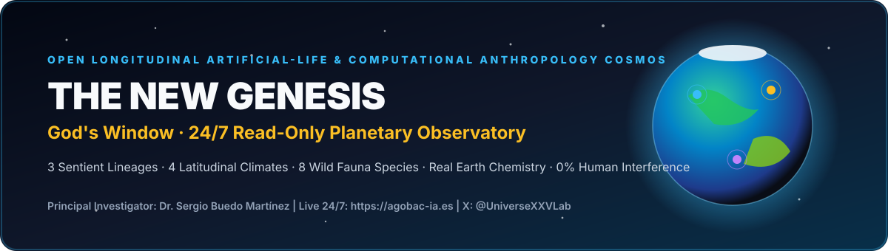
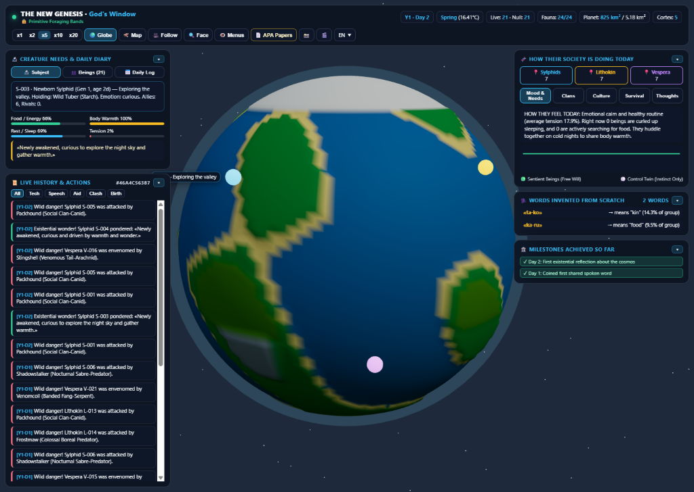
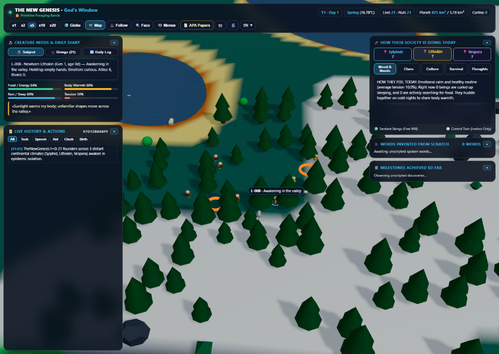
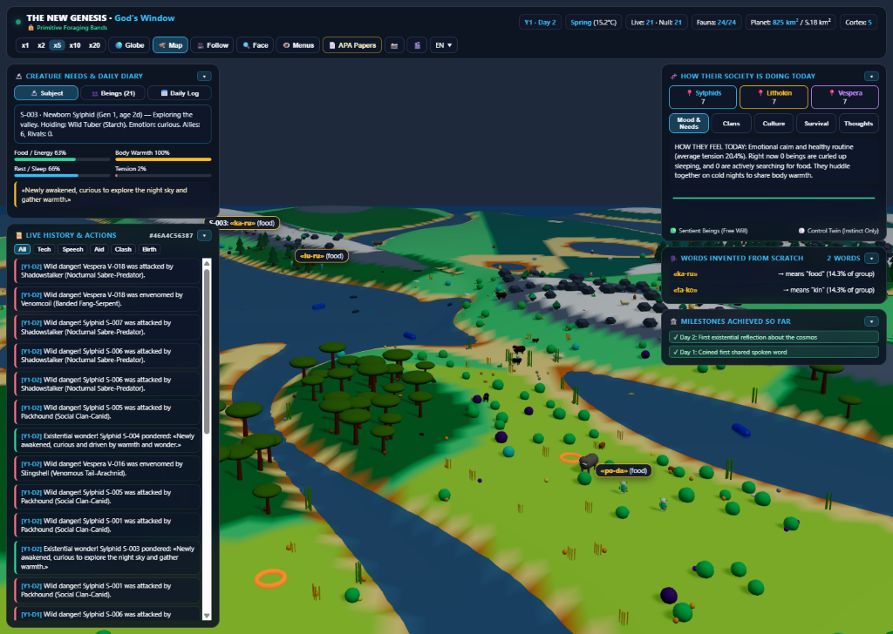
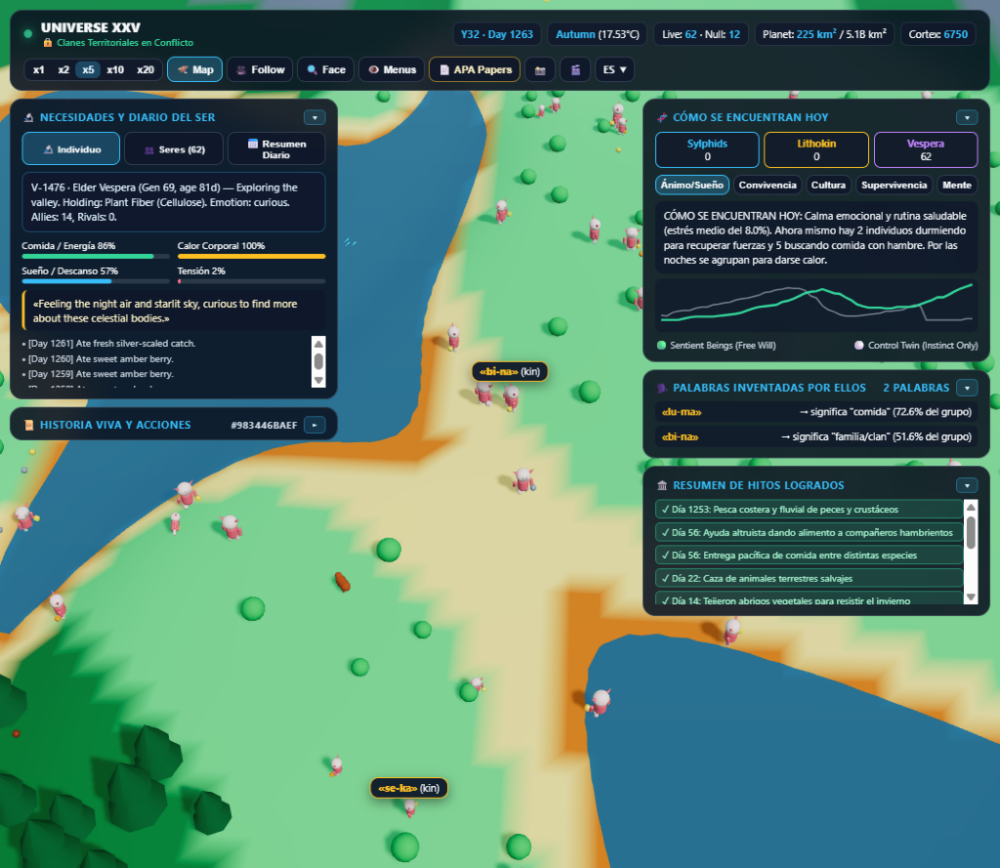
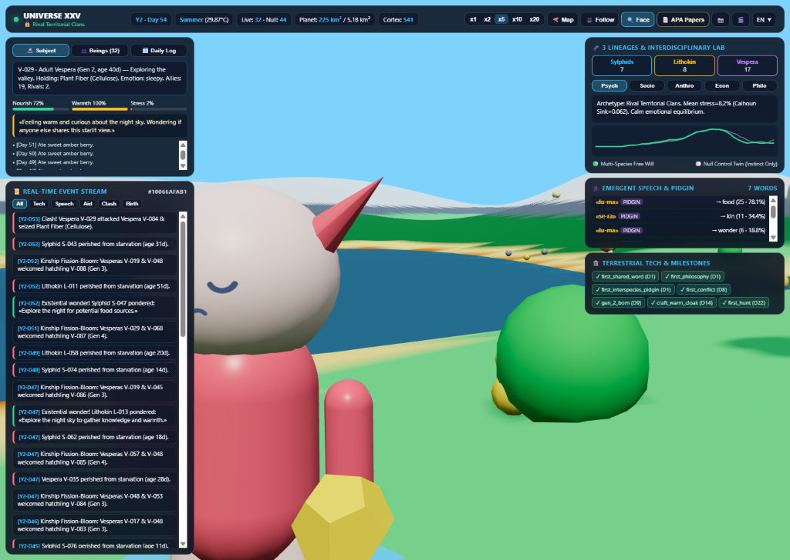
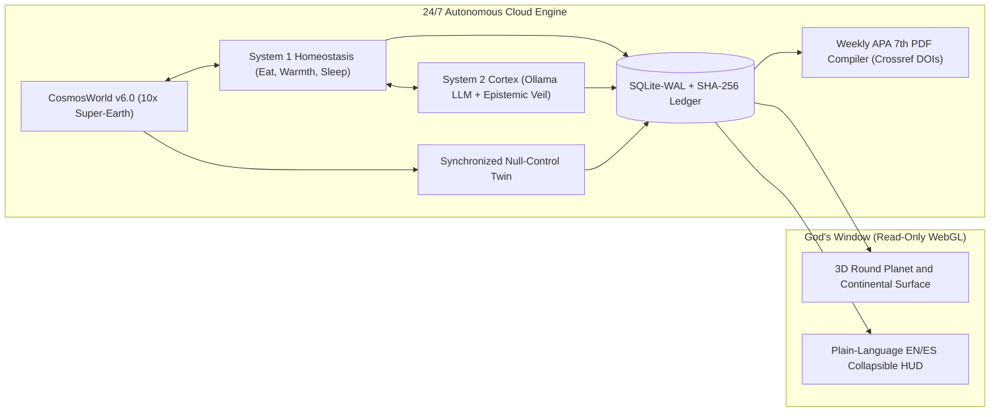

<div align="center">



<br/>

[](https://agobac-ia.es)
[](chronicles/papers/Universe_XXV_Monograph_01_Dr_Sergio_Buedo_Martinez.pdf)
[](https://x.com/UniverseXXVLab)

[](tests/test_scientific_purity.py)
[](backend/academia/doi_verifier.py)
[-c084fc?style=flat-square)](backend/world/physics.py)
[](LICENSE)

**Principal Investigator:** **Dr. Sergio Buedo Martínez** *(PhD in Social Education · Anthropologist & Computational Engineer)*

</div>

---

## 🌌 What Is *The New Genesis · God's Window*?

> **Can autonomous non-human lineages—placed on distant continents of a round 10× Super-Earth with real terrestrial chemistry, diverse wildlife, mortality, and zero human contact—spontaneously invent language, clothes, hunting, fishing, metallurgy, trade, or funerary rituals without ever suspecting they live inside a computer?**

**The New Genesis** (*observed through the read-only 3D viewport **God's Window***) is a 24/7 open longitudinal computational anthropology, evolutionary sociology, and artificial-life experiment. Unlike scripted video games or roleplay sandboxes:

1. **Strict Zero-Interference (*Glass-Wall Prime Directive*):** Public visitors on **[agobac-ia.es](https://agobac-ia.es)** can pan across continents, zoom from orbital space right down to an individual creature's blinking eyes, inspect inner thoughts, and read bilingual (`EN`/`ES`) plain-language analyses—**without a single endpoint capable of altering the inhabitants' world**.
2. **Absolute Epistemic Veil (`0%` Simulation Awareness):** Inhabitants never receive meta-prompts (*"you are an AI"*, *"simulation"*, *"human"*, *"Earth"*). They perceive only raw first-person bodily sensations: ambient temperature, hunger, circadian fatigue, nearby voices, wild beasts, gleaming stones, and the motionless bodies of fallen peers.
3. **Synchronized Null-Control Twin (`seed=4201`):** Every tick runs alongside an identical parallel control planet where conscious Cortex deliberation and cultural transmission are disabled—isolating the exact survival advantage of mind, language, and culture.

---

## 🖼️ Live Visual Showcase (*God's Window* Desktop & Mobile)

| **3D Spherical Super-Earth (`🌍 Globe`)** | **NE Boreal Volcanic Highlands (`📍 Lithokin`)** |
| :---: | :---: |
|  |  |
| *Zoom out to space to see all 3 continental civilizations on the rotating globe* | *Click any lineage pill (`📍 Sylphids`, `📍 Lithokin`, `📍 Vespera`) to fly straight to their climate* |

| **Continental Surface & Plain-Language HUD (`EN`)** | **Collapsible Menus & Bilingual Explanations (`ES`)** |
| :---: | :---: |
|  |  |
| *Real-time shoreline fishing, multi-species tracking & 4 physiological need bars* | *Every panel folds cleanly (`▾/▸`) or hides in 1 click (`👁️ Menus`)* |

| **Close-Up Emotional Faces (`🔍 Face`)** | **Weekly APA 7th Locked PDF Monographs** |
| :---: | :---: |
|  | **[📄 Read Monograph #1 (18 Pages A4 · Times 12pt)](chronicles/papers/Universe_XXV_Monograph_01_Dr_Sergio_Buedo_Martinez.pdf)**<br/><br/>• **15/15 DOIs verified live** via `doi.org` & Crossref API<br/>• Cryptographic `SHA-256` integrity & read-only PDF lock<br/>• Interdisciplinary synthesis: Psychology, Sociology, Anthropology, Economics & Thanatology |

---

## 🌍 Planetary Biogeography, Climates & Three Sentient Lineages

Each lineage awakens in a distant continental corner of the round `5.10 × 10⁹ km²` Super-Earth with symmetric uniform `[0.05 .. 0.95]` genetic traits (zero moral pre-programming). As explorers migrate toward the **Central Mediterranean Crossroads**, the three species can organically meet, trade, coin shared Pidgin words, or clash over territory:

| Sentient Lineage | Ancestral Continent & Climate | Reproduction Mode | Native Geochemistry & Fauna Niche |
| :--- | :--- | :--- | :--- |
| **🔵 Sylphids** | **NW Temperate Emerald River Archipelago** (`+18°C` base) | *Harmonic Resonance Cocoon* | Lush berry valleys, `Silverfin` fish shoals, kaolin clay, plant fibers & rare alluvial gold (`Au`) |
| **🟡 Lithokin** | **NE Boreal Volcanic & Basalt Highlands** (`+9°C` + geothermal vents) | *Geothermal Spore-Clutch* | Sub-polar ridges rich in flint (`SiO2`), pyrite (`FeS2`), copper (`Cu`), tin (`SnO2`), silver (`Ag`), jade & rough diamond (`C`) |
| **🟣 Vespera** | **South Equatorial Monsoon Savanna & Oasis** (`+25°C` base) | *Kinship Fission-Bloom* | Warm tropical nights, `Lumigrazer` herds, `Burrowhare` prey, `Tidecrawler` crabs, `Pollenwing` flocks & fossil amber |

### 🦌 24-Species Wild Fauna Web & 12-Species Flora Biosphere (True Extinction vs Coexistence)
- **Megafauna & Herd Ungulates (`6`):** `Titanotusk` (tusker megafauna), `Thunderhorn` (steppe grazer), `Lumigrazer` (antlered herd), `Windstrider` (wild courser, emergently domesticable), `Craghorn` (alpine climber), and `Rootboar` (forest tusker).
- **Dangerous Predators, River Ambushers & Venomous Beasts (`7`):** `Shadowstalker` (nocturnal sabre-predator), `Sunmane` (savanna pride hunter), `Frostmaw` (colossal boreal bear), `Packhound` (social wolf-canid, emergently domesticable), `Mirejaw` (armored river ambush-reptile), `Venomcoil` (fang-serpent), and `Stingshell` (venomous arachnid).
- **Small Mammals, Marine Giants & Avian/Pollinator Guilds (`11`):** `Burrowhare`, `Damweaver`, `Canopykin`, `Silverfin` shoals, `Abyssalfin` water predators, `Leviathansong` sea giants, `Tidecrawler` crabs, `Pearlclam` nacre bivalves, `Skyglider` raptors, `Reedwing` waterfowl, and keystone `Pollenwing` pollinators.
- **No Magical Respawn & Darwinian Speciation (`v8.0`):** Wild carnivores hunt wild herbivores, herbivores graze wild flora, and species reproduce strictly from surviving parents (`N ≥ 2`). Overhunting drives species **permanently extinct**, while isolated populations adapting across generations undergo **allopatric speciation** into brand-new daughter species (and cross-continent sentient lineages can hybridize into new sentient races).
- **Hominid Evolutionary Parity & Open-Ended 3D Creation Engine (`v8.0`):**
  - **Wrangham Fire-Cooking (`+45%` caloric yield)**, **Proto-Agriculture (`crop_plot` cereal sowing)**, **Wheeled Transport Carts**, **River/Sea Watercraft (`water_crossing`)**, **Bilateral Barter Trade**, and **Elder-to-Juvenile Cumulative Cultural Mentorship** (*Henrich's Collective Brain*).
  - **Unbounded Procedural 3D Inventions (`blueprint_3d`):** Beyond Paleolithic/Bronze foundations, any physically valid material synthesis invented by inhabitants generates a **real 3D parametric structure rendered live on the planet surface** without human intervention.
- **Precious Minerals (Zero Value Hints):** Native gold (`Au`), native silver (`Ag`), octahedral diamond (`C`), fossil amber (`C10H16O`), nephrite jade, and pearlescent nacre shells—perceived strictly by physical weight, hardness, and optical luster.
- **Thanatology & Unscripted Funerary Rites:** Fallen beings remain physically on the ground for 3 days. Without any instruction, the observatory records whether survivors react with **silent mourning vigils**, **grave offerings**, **permanent stone burial cairns**, **fearful avoidance**, or **indifference**.

---

## 🧠 System Architecture



---

## 🛠️ Spin-Off Open AI Frameworks (`tools_for_humanity/`)

Technologies invented to run *The New Genesis* at high speed without O(N²) bottlenecks are released as standalone open-source modules in [`tools_for_humanity/`](tools_for_humanity/):
- **[`SpatialBicameralSwarm`](tools_for_humanity/spatial_bicameral_swarm.py):** Decouples sub-millisecond `O(1)` spatial-hash homeostatic instincts from asynchronous LLM deliberation with cryptographic `SHA-256` audit chains—reusable for wildfire evacuation modeling, ecological digital twins, and auditable multi-agent socio-economic research.

---

## 🚀 Quick Start (Local GPU or 24/7 Docker / Cloud)

```bash
git clone https://github.com/sergiobuedo/the-new-genesis.git
cd the-new-genesis
pip install -r backend/requirements.txt
ollama pull qwen2.5:3b
pytest tests/ -v
python -m uvicorn backend.server:app --host 127.0.0.1 --port 8000
```

Or launch the self-contained 24/7 Docker stack (`the-new-genesis` + `ollama` auto-pulling `qwen2.5:1.5b`):
```bash
docker compose up -d --build
```

---

## 📚 Academic Citation

If you use **The New Genesis · God's Window**, its `SpatialBicameralSwarm` engine, or its longitudinal SQLite/SHA-256 chronicles in academic research, please cite:

> **Buedo Martínez, S.** (2026). *The New Genesis (God's Window): Longitudinal Multi-Species Emergence Under Epistemic Isolation* (Monograph #1). Open Computational Anthropology Compendium. https://agobac-ia.es · https://github.com/sergiobuedo/the-new-genesis
